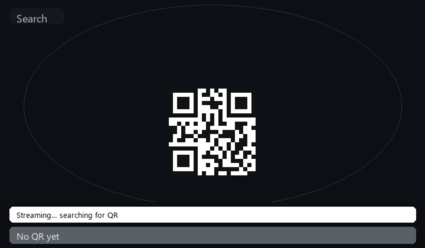

# GlassesQR

Android demo that streams a Meta glasses camera (or a MockDeviceKit phone-camera stand-in), detects QR codes, and draws a **green outline that rotates and follows the code in real time**.



The clip above is the same loop you see on the phone: search → lock onto the QR → keep the outline on its corners while it moves and tilts.

## What you get on screen

- Live preview of the glasses camera feed
- ML Kit QR decode on the latest frame as soon as the previous decode finishes
- Outline drawn from the QR **corner points**, so the box tilts with the code instead of staying upright
- Decoded payload in the green result bar

## How it works

1. `GlassesApp` enables **MockDeviceKit**, then calls `Wearables.initialize()`.
2. After camera permission, the mock Ray-Ban Meta is powered on, donned, and given the phone **back camera** as its feed.
3. A DAT `DeviceSession` starts. When it reports `STARTED`, the app adds a camera at 30 fps and collects `stream.videoStream`.
4. Raw I420 frames are converted to NV21, shown in `imgPreview`, and sent to ML Kit.
5. Each detection stores the four corners; the next preview frame draws a closed green path through them.

## Run it

Needs Android Studio, Android 10+ (API 29), and a physical phone (the mock back-camera feed uses the handset camera).

1. Open this folder in Android Studio.
2. Connect a phone and grant USB debugging.
3. Run the `app` configuration.
4. Grant **camera** permission when asked.
5. Point the phone at a QR code. After a short warmup, the preview and green outline should appear.

```bash
./gradlew assembleDebug
./gradlew installDebug
```

On Windows, use `gradlew.bat`. The first frames can look soft; wait a moment for the mock camera feed to settle.

## Project layout

| Path | Role |
|---|---|
| `app/src/main/java/com/example/glassesqr/GlassesApp.kt` | MockDeviceKit + DAT init |
| `app/src/main/java/com/example/glassesqr/MainActivity.kt` | Session, stream, QR scan, overlay |
| `app/src/main/res/layout/activity_main.xml` | Preview + status HUD |
| `docs/qr-tracking.gif` | README animation of detect + track |

DAT SDK **1.0.1** (`mwdat-core`, `mwdat-camera`, `mwdat-mockdevice`). Developer Mode credentials in the manifest are placeholders (`0`), which is enough for MockDeviceKit.

To regenerate the animation:

```bash
python docs/generate_qr_tracking_gif.py
```
